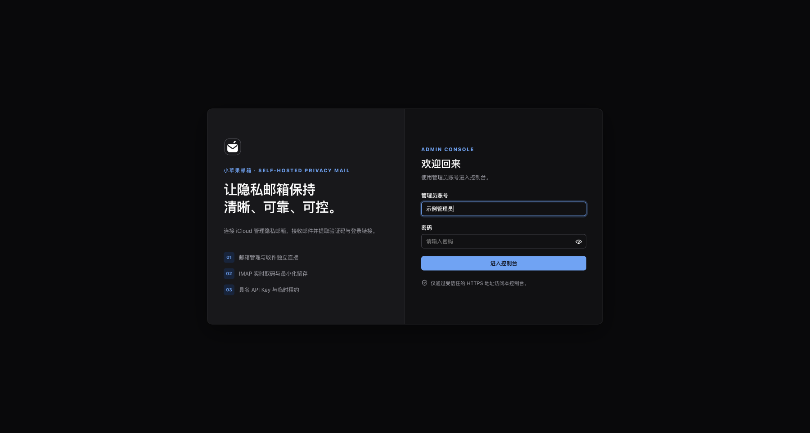
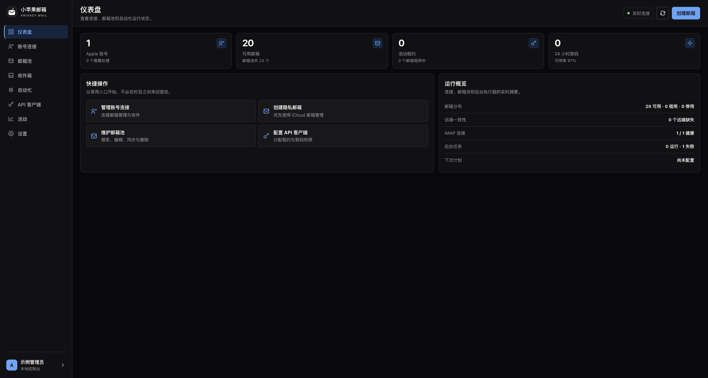
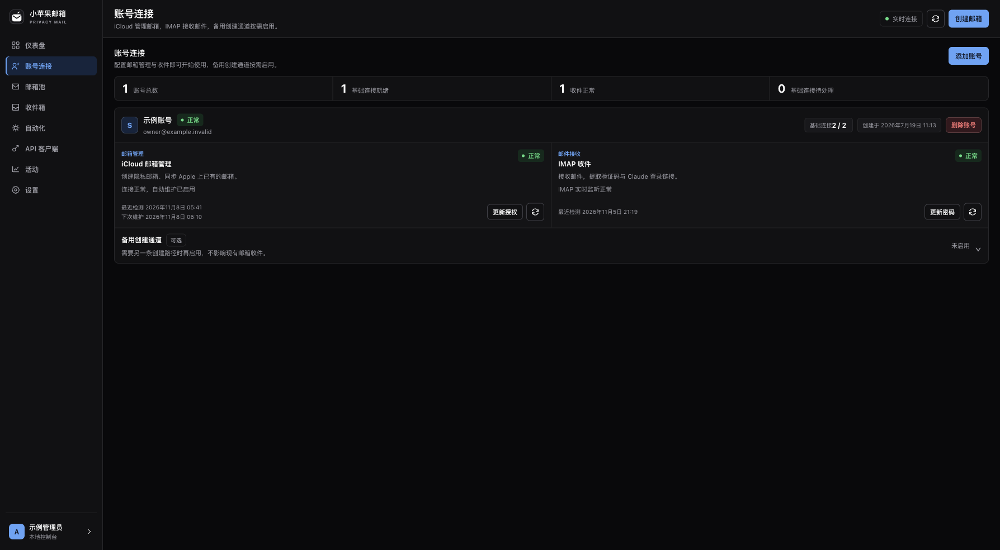
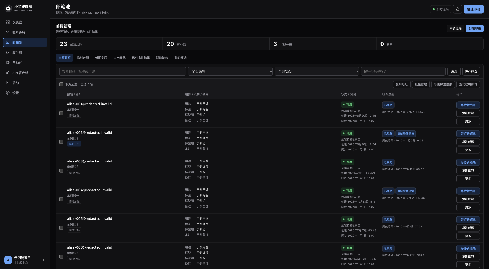
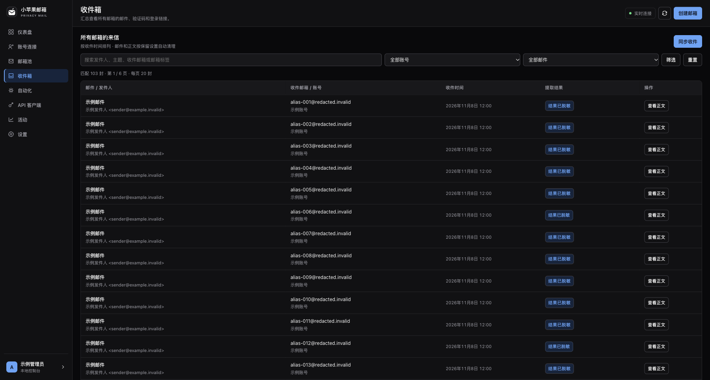
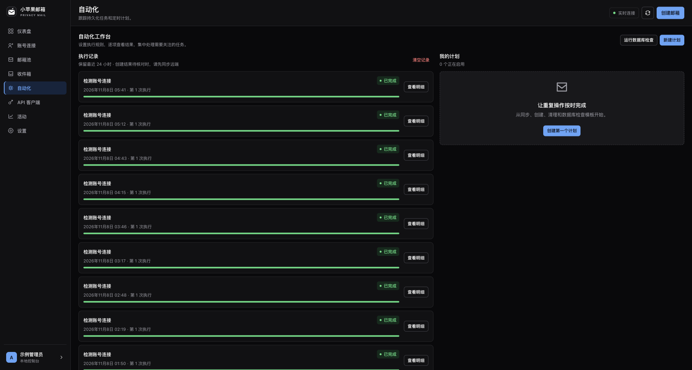
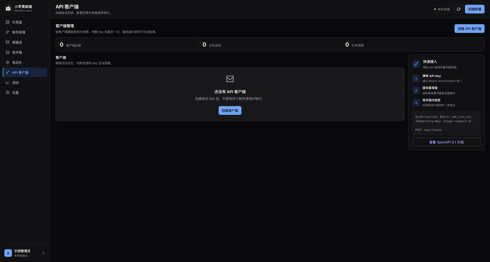
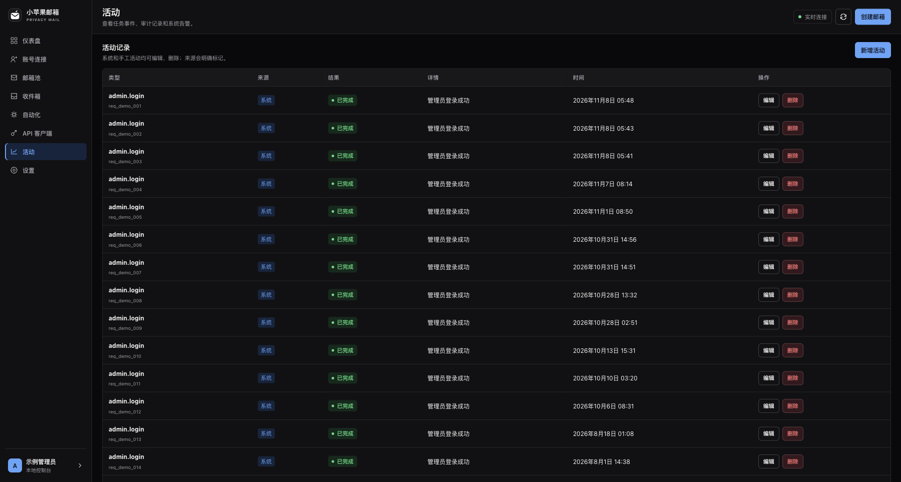
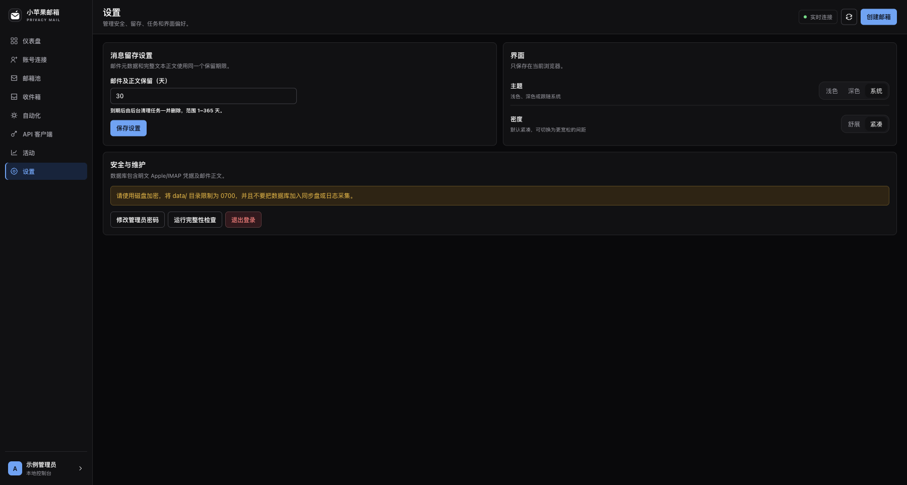

# 小苹果邮箱

  

<strong>面向个人自托管的 Hide My Email 控制台</strong>

  连接 iCloud、管理隐私邮箱、同步收件，并通过 API 安全地等待验证码。

  
  
  
  

> 项目适合单机、自托管、单管理员场景。它不保存 Apple 密码，也不会打开邮件中的链接；连接凭据和 IMAP App 专用密码会按产品设计保存在本地 SQLite 中，请先阅读[安全边界](#安全边界)。

## 界面预览

以下截图来自真实运行中的管理控制台，页面中的账号、邮箱地址、邮件标题、验证码、请求 ID 和备注已替换为不可逆的示例值。

<table>
  <tr>
    <td></td>
    <td></td>
  </tr>
  <tr>
    <td align="center">登录页</td>
    <td align="center">仪表盘</td>
  </tr>
  <tr>
    <td></td>
    <td></td>
  </tr>
  <tr>
    <td align="center">账号连接</td>
    <td align="center">邮箱池</td>
  </tr>
  <tr>
    <td></td>
    <td></td>
  </tr>
  <tr>
    <td align="center">收件箱</td>
    <td align="center">自动化</td>
  </tr>
  <tr>
    <td></td>
    <td></td>
  </tr>
  <tr>
    <td align="center">API 客户端</td>
    <td align="center">活动</td>
  </tr>
  <tr>
    <td></td>
    <td></td>
  </tr>
  <tr>
    <td align="center">设置</td>
    <td></td>
  </tr>
</table>

## 为什么做它

小苹果邮箱是一个带 Web 管理后台的本地邮箱服务，支持统一管理多个 iCloud 账号、邮箱池和收件同步。它将账号配置、验证码提取和自动化能力集中在一个可备份、可审计、可通过 API 调用的服务中，避免把收件逻辑分散在脚本、浏览器插件和临时数据库里。

## 功能

- **连接管理**：分别管理 Apple 账号创建通道、iCloud 邮箱管理和 IMAP 收件连接。
- **邮箱池**：同步 Hide My Email 地址，支持临时分配、长期专用、标签、用途和批量管理。
- **收件与取码**：IMAP 增量同步、IDLE 实时监听、断点恢复，提取 4–8 位验证码和 Claude 登录链接。
- **租约 API**：具名 API Key、权限域、幂等创建、续期、释放、自动过期回收和验证码消费。
- **持久化任务**：邮箱创建、远端同步、收件同步、远端清理、留存清理和数据库检查都进入 SQLite 任务队列。
- **自动化**：按间隔执行计划，支持逐项结果、失败重试、取消执行和 SSE 实时状态。
- **安全控制**：Argon2id、CSRF、双期限 Session、登录限流、严格响应头和可信代理配置。

## 工作方式

~~~mermaid
flowchart LR
    UI[管理后台] --> HTTP[HTTP API]
    Client[外部自动化] --> HTTP
    HTTP --> Store[(SQLite WAL)]
    HTTP --> Jobs[持久化任务队列]
    Jobs --> Providers[连接与同步服务]
    Providers --> Apple[iCloud / Hide My Email]
    Providers --> IMAP[IMAP / IDLE]
    IMAP --> Store
    Apple --> Store
~~~

服务启动时会自动迁移数据库到当前 Schema 5，初始化 Worker 和 IMAP 监听器，然后提供管理页面、健康检查和 API。收件邮件与 IMAP 游标在同一个事务中保存；租约分配使用幂等键和数据库唯一约束，避免网络重试造成重复分配。

## 快速开始

需要 Docker Engine、Docker Compose V2，以及一个启用双重认证的 Apple 账号。收件功能还需要 iCloud 邮箱地址和 App 专用密码。

~~~bash
cp .env.example .env
mkdir -p data
chmod 600 .env
chmod 700 data
~~~

编辑 .env，先使用本地地址完成首次启动：

~~~dotenv
SAM_ADMIN_USERNAME=admin
SAM_ADMIN_PASSWORD=替换为随机长密码
SAM_PUBLIC_BASE_URL=http://127.0.0.1:18787
SAM_COOKIE_SECURE=false
~~~

启动服务：

~~~bash
docker compose config --quiet
docker compose build
docker compose up -d
docker compose ps
~~~

默认端口只绑定到本机 127.0.0.1:18787：

~~~bash
curl http://127.0.0.1:18787/healthz
curl http://127.0.0.1:18787/readyz
~~~

本地管理后台地址是 [http://127.0.0.1:18787/login](http://127.0.0.1:18787/login)。打开后完成管理员登录，再按以下顺序配置：

1. 添加 Apple 账号。
2. 配置 iCloud 邮箱管理和 IMAP 收件连接。
3. 同步远端隐私邮箱，或登记已有邮箱。
4. 创建具名 API 客户端并保存完整 Key。
5. 让外部程序通过租约 API 申请临时邮箱并等待验证码。

首次管理员写入数据库后，可以从 .env 删除 SAM_ADMIN_PASSWORD，再执行：

~~~bash
docker compose up -d --force-recreate
~~~

如果部署到公网，请把 SAM_PUBLIC_BASE_URL 改成你的 HTTPS 地址（例如 https://mail.example.com），把 SAM_COOKIE_SECURE 改为 true，并在前面使用 Nginx 或 Caddy 提供 HTTPS；反向代理网段配置到 SAM_TRUSTED_PROXY_CIDRS。

## API 示例

完整接口定义见 internal/app/web/openapi.json，运行后也可通过 GET /api/openapi.json 访问。

下面示例默认访问本机服务；部署到公网时，将 BASE_URL 替换成你的 HTTPS 地址。

~~~bash
BASE_URL=http://127.0.0.1:18787
~~~

申请一个临时邮箱：

~~~bash
curl -X POST "$BASE_URL/api/leases" \
  -H 'Authorization: Bearer sam_live_xxx' \
  -H 'Idempotency-Key: signup-run-001' \
  -H 'Content-Type: application/json' \
  -d '{"project":"signup-tests","purpose":"接收注册验证码","ttl_seconds":1800}'
~~~

使用租约等待验证码：

~~~bash
curl "$BASE_URL/api/leases/lease_xxx/code?after=2026-01-01T00:00:00Z&wait_seconds=30" \
  -H 'Authorization: Bearer sam_live_xxx' \
  -H 'X-Lease-Token: sam_lease_xxx'
~~~

公共租约 API 只返回验证码，不返回邮件正文或登录链接。单邮箱取码 API 支持 Authorization: Bearer ...，比把 Key 放进 URL 更适合服务间调用。

## 配置

| 变量 | 默认值 | 说明 |
| --- | --- | --- |
| SAM_ADMIN_USERNAME | 无 | 首次启动管理员用户名，3–64 个字符 |
| SAM_ADMIN_PASSWORD | 无 | 首次启动管理员密码，8–32 个字符 |
| SAM_PUBLIC_BASE_URL | 空 | 生成单邮箱 API 地址时使用的公开根地址 |
| SAM_COOKIE_SECURE | false | HTTPS 部署必须设为 true |
| SAM_SESSION_IDLE_MINUTES | 720 | Session 空闲期限，范围 5–43200 分钟 |
| SAM_SESSION_ABSOLUTE_HOURS | 168 | Session 绝对期限，范围 1–8760 小时 |
| SAM_WORKER_CONCURRENCY | 3 | Worker 并发数，范围 1–16 |
| SAM_TRUSTED_PROXY_CIDRS | 空 | 可信反向代理网段，多个 CIDR 用逗号分隔 |

## 安全边界

- 管理员密码、Web Session、API Key、租约 Token 和单邮箱 Key 只保存不可逆哈希。
- Apple/iCloud Cookie、Session Token、Trust Token 和 IMAP App 专用密码以明文 JSON 保存在 SQLite；读取数据库文件基本等价于取得相关账号的远端访问能力。
- Apple/iCloud 邮箱管理使用非公开网页协议，Apple 调整风控、端点或登录流程后可能需要适配。
- 2FA 待验证状态只保存在当前进程内，服务重启后需要重新发起登录。
- 邮件正文、验证码和登录链接按设置的留存天数清理，默认 30 天。
- 系统只离线解析 Claude 登录链接，不访问链接、不跟踪跳转、不加载图片，也不请求 Claude 或 Anthropic 域名。
- 数据目录建议使用 0700，数据库文件建议使用 0600，不要把 data/ 放入 Git、普通同步盘或日志采集系统。

## 从源码运行

要求 Go 1.26.8 或更高版本：

~~~bash
set -a
. ./.env
set +a
go run ./cmd/small-apple-mail serve --database data/small-apple-mail.db
~~~

可用命令：

~~~text
small-apple-mail serve [--host HOST] [--port PORT] [--database PATH]
small-apple-mail admin reset-password [--database PATH]
small-apple-mail store verify [--database PATH]
~~~

开发验证：

~~~bash
test -z "$(gofmt -l .)"
go vet ./...
go test ./...
go test -race ./...
python3 -m json.tool internal/app/web/openapi.json >/dev/null
docker compose config --quiet
~~~

## 数据库与升级

数据库文件默认为 data/small-apple-mail.db。启动时会自动完成本项目 Schema 1–4 到 Schema 5 的迁移，不导入更早的 JSON 状态文件。升级前建议停服并备份：

~~~bash
docker compose stop app
cp data/small-apple-mail.db "data/small-apple-mail.db.$(date -u +%Y%m%dT%H%M%SZ).bak"
docker compose start app
~~~

完整校验：

~~~bash
docker compose exec app /app/small-apple-mail store verify --database /app/data/small-apple-mail.db
~~~

## 项目结构

~~~text
cmd/small-apple-mail/       CLI、服务启动与维护命令
internal/app/config/        环境变量与启动配置
internal/app/domain/        领域模型和状态常量
internal/app/protocol/      Apple、iCloud Web 与 IMAP 协议实现
internal/app/repository/    SQLite Schema、迁移与持久化
internal/app/providers/     后台任务处理器与 IMAP 管理器
internal/app/services/      验证码和登录链接提取
internal/app/httpserver/    管理接口、公共 API、认证与 SSE
internal/app/web/           嵌入式页面、静态资源和 OpenAPI 文档
internal/app/worker/        持久化任务队列执行器
docs/assets/                README 图片预览
~~~

## 参与贡献

欢迎提交 Issue、改进协议适配、补充测试和优化界面。涉及 Apple 登录、会话 Cookie、IMAP 密码或真实邮箱的内容，请使用合成数据；不要在 Issue、Pull Request、日志或截图中提交真实凭据。

报告安全问题时，请避免公开披露可复现凭据或远端账号信息，并在修复前使用私下渠道联系维护者。

## 社区交流

- [Linux.do 社区](https://linux.do/)

欢迎通过 GitHub Issues 或 Linux.do 反馈问题和建议。

## 许可证

本项目使用 Apache-2.0，详见 LICENSE。
